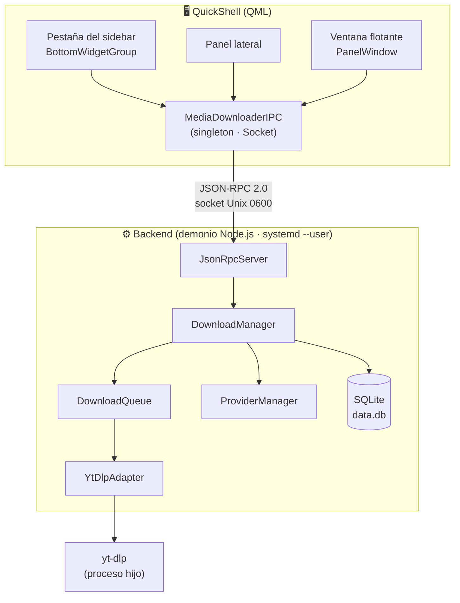
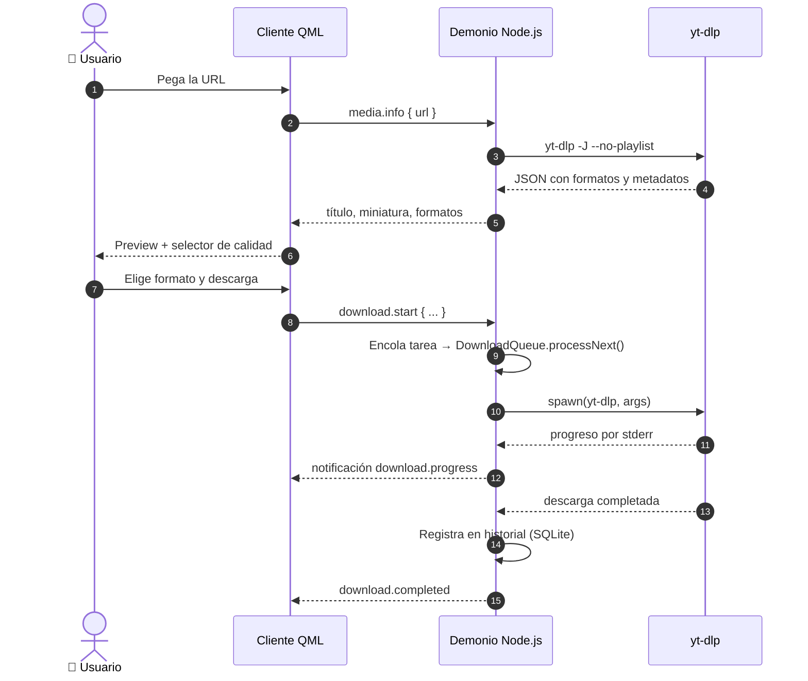

<div align="center">

# 📥 Media Download Center

**Centro de descargas multimedia para Hyprland + QuickShell (Illogical‑Impulse)**

Baja vídeo y audio de **8 plataformas** sin salir de tu escritorio:
backend demonio en Node.js, interfaz nativa en QML, IPC por socket Unix
y cola persistente en SQLite.

[](#)
[](LICENSE)
[](#-requisitos)
[](#-requisitos)
[](https://github.com/Illogical-Impulse/Quickshell)
[](https://hyprland.org)
[](#-proveedores-soportados)

<a href="#-características">Características</a> ·
<a href="#-instalación-rápida">Instalación</a> ·
<a href="#-uso">Uso</a> ·
<a href="#-proveedores-soportados">Proveedores</a> ·
<a href="#-solución-de-problemas">Problemas</a> ·
<a href="#-arquitectura">Arquitectura</a> ·
<a href="#-licencia">Licencia</a>

</div>

---

> [!WARNING]
> **Usa esta herramienta solo con contenido que tengas derecho a descargar.**
> Respeta los términos de servicio de cada plataforma y las leyes de propiedad
> intelectual de tu país. Tú eres el único responsable del uso que le des.

---

## 📋 Tabla de Contenidos

- [✨ Características](#-características)
- [📸 Capturas](#-capturas)
- [📦 Requisitos](#-requisitos)
- [🚀 Instalación Rápida](#-instalación-rápida)
- [🔧 Instalación Manual](#-instalación-manual)
- [🎮 Uso](#-uso)
- [🖥️ Modos de Visualización](#️-modos-de-visualización)
- [🔌 Proveedores Soportados](#-proveedores-soportados)
- [🔍 Solución de Problemas](#-solución-de-problemas)
- [🏗️ Arquitectura](#️-arquitectura)
- [💻 Desarrollo](#-desarrollo)
- [⚖️ Advertencias Legales](#️-advertencias-legales)
- [📄 Licencia](#-licencia)

---

## ✨ Características

### 🎬 Descarga

| | |
|---|---|
| 🎥 **8 plataformas** | YouTube, Twitch, TikTok, Instagram, Twitter/X, Vimeo, SoundCloud y Bandcamp |
| 🎵 **Solo audio** | MP3, FLAC, AAC, OPUS, OGG y WAV |
| 📊 **Selector de calidad** | Desde 144p hasta 2160p (4K) |
| 📝 **Subtítulos** | Descarga e incrustación automática |
| 🖼️ **Miniaturas** | Descarga e incrustación automática |
| 🍪 **Cookies del navegador** | Para servicios con verificación anti‑bot (YouTube, Instagram) |

### 🗂️ Gestión

- 📦 **Cola de descargas** con control de concurrencia y reintentos automáticos
- ⏸️ **Pausar / reanudar** descargas en caliente (`SIGSTOP` / `SIGCONT`)
- 📜 **Historial** completo con buscador
- ⭐ **Favoritos** para marcar tus descargas importantes
- ⚙️ **Configuración persistente**: ruta, formato, calidad, concurrencia

### 🖥️ Integración

- 🛡️ **Descargas a prueba de UI** — el backend es un **demonio independiente**:
  cerrar la barra lateral o el panel flotante **no interrumpe** nada
- ♻️ **Reanudación tras reinicio** — las descargas en curso se re‑encolan al
  arrancar el demonio y yt‑dlp continúa el `.part` que quedó a medias
- 🔄 **Cliente reconectable** — la UI reintenta cada 2 s y arranca el servicio
  por systemd si hace falta
- 🧩 **Cola única compartida** entre sidebar y panel flotante
- 🪟 **3 modos de visualización**: pestaña, panel lateral y ventana flotante

---

## 📸 Capturas

> 🚧 *Pendiente.* Si quieres colaborar, sube capturas del widget, del panel y del
> modo flotante a `docs/capturas/` y enlázalas aquí.

---

## 📦 Requisitos

| Dependencia | Versión mínima | Instalación |
|-------------|:--------------:|-------------|
| **Node.js** | 18.0.0 | `sudo pacman -S nodejs` |
| **npm** | — | `sudo pacman -S npm` |
| **yt-dlp** | 2024.0+ | `sudo pacman -S yt-dlp` |
| **QuickShell** | última | [Illogical-Impulse/Quickshell](https://github.com/Illogical-Impulse/Quickshell) |
| **TypeScript** | 5.0+ | `npm install -g typescript` *(solo desarrollo)* |

> 💡 **Nota**: QuickShell (Illogical‑Impulse) es un fork de
> [Quickshell](https://github.com/Quickshell/Quickshell). Los módulos QML están
> escritos específicamente para ese entorno (`qs -c ii`).

---

## 🚀 Instalación Rápida

```bash
# 1. Clona el repositorio donde prefieras
git clone <url-del-repositorio> ~/Proyectos/DownLoadsManagerEnd4
cd ~/Proyectos/DownLoadsManagerEnd4

# 2. Da permisos de ejecución y lanza el instalador
chmod +x install.sh
./install.sh

# 3. Recarga QuickShell (config ii)
pkill -x qs && qs -c ii &
```

### ¿Qué hace `install.sh`?

Pipeline idempotente de **7 pasos**, con backups `*.mdc-backup` antes de tocar nada:

| Paso | Acción |
|:----:|--------|
| 1 | Verifica dependencias (`node`, `npm`, `yt-dlp`) y versiones mínimas |
| 2 | `npm ci` + compilación TypeScript (`npm run build`) |
| 3 | Copia los módulos QML a `~/.config/quickshell/ii/modules/ii/mediaDownloader/` |
| 4 | Integra el widget en la config QuickShell (tabs, imports, `PanelLoader`, `IpcHandler`) |
| 5 | Añade la pestaña «Descargas» al `BottomWidgetGroup` |
| 6 | Instala el **demonio `systemd --user`** y el atajo `CTRL + SUPER + D` en Hyprland |
| 7 | **Smoke test** del backend (ping JSON‑RPC por el socket) |

> 📖 Detalle completo de pasos, protocolo IPC y mapa de archivos:
> [`docs/MAPA_FUNCIONAMIENTO.md`](docs/MAPA_FUNCIONAMIENTO.md)

**Flags disponibles**

```bash
./install.sh --no-integrate   # Instala sin tocar tu configuración de QuickShell
./install.sh --uninstall      # Revierte todo (módulos, servicio, atajo, backups)
```

---

## 🔧 Instalación Manual

<details>
<summary><b>Desplegar paso a paso sin el instalador</b></summary>

<br>

### 1. Clonar e instalar dependencias

```bash
git clone <url-del-repositorio> ~/Proyectos/DownLoadsManagerEnd4
cd ~/Proyectos/DownLoadsManagerEnd4
npm install
```

### 2. Compilar TypeScript

```bash
npm run build
```

### 3. Copiar los módulos QML

```bash
mkdir -p ~/.config/quickshell/ii/modules/ii/mediaDownloader
cp qml/*.qml ~/.config/quickshell/ii/modules/ii/mediaDownloader/
```

### 4. Instalar el demonio

```bash
# El socket del demonio es el que alimenta la UI
install -Dm644 packaging/media-download-center.service \
  ~/.config/systemd/user/media-download-center.service
systemctl --user daemon-reload
systemctl --user enable --now media-download-center
```

### 5. Integrar en QuickShell (`ii`)

`install.sh` edita estos archivos de forma idempotente y con backup:

- `~/.config/quickshell/ii/GlobalStates.qml` → propiedad `mediaDownloaderFloatingOpen`
- `~/.config/quickshell/ii/panelFamilies/IllogicalImpulseFamily.qml` → import + `PanelLoader`
- `~/.config/quickshell/ii/shell.qml` → `IpcHandler` con target `mediaDownloader`
- `~/.config/quickshell/ii/modules/ii/sidebarRight/BottomWidgetGroup.qml` → pestaña «Descargas»

Si prefieres hacerlo a mano, usa `./install.sh --no-integrate` y replica esas
ediciones consultando el
[mapa de funcionamiento](docs/MAPA_FUNCIONAMIENTO.md#7-integración-con-hyprland--quickshell-ii).

### 6. Atajo global en Hyprland

```lua
-- ~/.config/hypr/custom/keybinds.lua
hl.bind("CTRL + SUPER + D", hl.dsp.global("quickshell:mediaDownloaderFloatingToggle"),
    { description = "Shell: Toggle media downloader" })
```

### 7. Recargar QuickShell

```bash
touch ~/.config/quickshell/ii/shell.qml
```

</details>

---

## 🎮 Uso

### Interfaz básica

1. **Abre el panel** desde el botón en la barra lateral o con el atajo global
2. **Pega un enlace** en el campo de URL (YouTube, Twitch, TikTok…)
3. **Selecciona formato y calidad** en los menús desplegables
4. **Descarga** — el archivo se guarda en `~/Descargas/MediaDownloadCenter`

### Panel de control

| Pestaña | Función |
|---------|---------|
| **Activo** | Descargas en progreso, pausadas y en cola |
| **Historial** | Todas las descargas completadas, con buscador |
| **Favoritos** | Descargas marcadas como favoritas |
| **Config** | Ruta de destino, concurrencia, miniaturas, subtítulos y cookies (anti‑bot) |
| **Logs** | Registros de depuración y errores |

### Atajos

| Atajo | Acción |
|-------|--------|
| `Ctrl + V` | Pegar desde el portapapeles en el campo de URL |
| `Enter` | Analizar el enlace; si ya está analizado, iniciar la descarga |
| `Escape` | Limpiar el campo de URL |
| `CTRL + SUPER + D` | Abrir/cerrar el panel flotante *(atajo global de Hyprland)* |

> ⚠️ `SUPER + D` **no** sirve: Hyprland ya lo usa para «Window: Maximize».

También puedes abrir el panel por IPC, desde terminal o scripts:

```bash
qs -c ii ipc call mediaDownloader toggle
```

---

## 🖥️ Modos de Visualización

| Modo | Dónde vive | Para qué sirve |
|------|-----------|----------------|
| **Pestaña** | `BottomWidgetGroup` del sidebar | Tres vistas conmutables: **Descargar** (enlace → preview → formato), **Activas** (cola en vivo con pausa/cancelar) e **Historial** (completadas, buscador y favoritos) |
| **Panel** | Barra lateral derecha | Panel completo con historial, favoritos, configuración y logs |
| **Flotante** | `PanelWindow` independiente | Ventana suelta que se abre/cierra con el atajo global |

Los tres comparten los mismos componentes QML (`MediaActiveList`, `MediaHistoryList`,
`DownloadProgressCard`), así que **siempre muestran la misma cola**.

---

## 🔌 Proveedores Soportados

| Proveedor | Vídeo | Audio | Playlist/Canales | Subtítulos | Miniaturas |
|-----------|:-----:|:-----:|:----------------:|:----------:|:----------:|
| **YouTube** | ✅ | ✅ | ✅ | ✅ | ✅ |
| **Twitch** | ✅ | ✅ | ❌ | ❌ | ✅ |
| **TikTok** | ✅ | ✅ | ❌ | ❌ | ✅ |
| **Instagram** | ✅ | ✅ | ❌ | ❌ | ✅ |
| **Twitter/X** | ✅ | ✅ | ❌ | ❌ | ✅ |
| **Vimeo** | ✅ | ✅ | ❌ | ❌ | ✅ |
| **SoundCloud** | ❌ | ✅ | ❌ | ❌ | ✅ |
| **Bandcamp** | ❌ | ✅ | ❌ | ❌ | ✅ |

---

## 🔍 Solución de Problemas

<details>
<summary><b>🔌 La UI dice «Sin conexión con el demonio de descargas»</b></summary>

<br>

La interfaz (QuickShell) y el backend (demonio) son procesos independientes que
se hablan por un socket Unix. Si no existe, arráncalo:

```bash
systemctl --user start media-download-center
```

La UI reintenta la conexión cada 2 s y, además, pide a systemd que arranque el
servicio, así que normalmente se recupera sola.

</details>

<details>
<summary><b>⚙️ El backend no inicia</b></summary>

<br>

```bash
# Estado del demonio (es un servicio de usuario, NO un hijo de QuickShell)
systemctl --user status media-download-center

# Logs del backend
journalctl --user -u media-download-center -n 50

# ¿Existe el socket al que se conecta la UI?
ls -l "${XDG_RUNTIME_DIR}/media-download-center.sock"

# Verifica que yt-dlp está instalado
yt-dlp --version
```

</details>

<details>
<summary><b>⛔ Las descargas fallan inmediatamente</b></summary>

<br>

```bash
# Verifica la versión de yt-dlp (debe ser 2024+)
yt-dlp --version

# Prueba con un vídeo simple
yt-dlp -f "best[height<=720]" -o "/tmp/test.mp4" "https://www.youtube.com/watch?v=dQw4w9WgXcQ"
```

</details>

<details>
<summary><b>🧩 El vídeo queda a medias y no se puede reproducir</b></summary>

<br>

Si la descarga se cancela o la app se cierra a mitad, yt‑dlp deja el archivo
como `Nombre.mp4.part`: es el trozo descargado, no un vídeo reproducible.
Vuelve a lanzar la misma descarga y yt‑dlp reanuda desde ese `.part`.

La barra de progreso debe ir avanzando; si se quedaba fija en 0 % era un fallo
corregido del adaptador (faltaba `--progress`), y al cancelar la descarga se
reiniciaba sola (el reintento automático revivía tareas canceladas).

**Solución**: actualiza el código (`git pull && npm run build`) y reinicia el
módulo QML.

</details>

<details>
<summary><b>⏱️ «Request media.info timed out» (YouTube u otros)</b></summary>

<br>

El análisis del enlace se hace con yt‑dlp y puede tardar; el límite del cliente
es de **75 s** para que el backend (45 s) tenga tiempo de devolver el **motivo
real** en lugar de un timeout genérico.

Si el error real es *«Sign in to confirm you're not a bot»* o similar, el
servicio exige sesión iniciada: activa cookies en **Config → Cookies (anti‑bot)**
eligiendo tu navegador (Firefox, Chrome, Chromium, Brave…), o indica la ruta a
un `cookies.txt`. Ver el bloque siguiente.

</details>

<details>
<summary><b>🍪 Servicios que piden sesión (YouTube / Instagram)</b></summary>

<br>

YouTube bloquea las descargas anónimas desde algunas IP con
`Sign in to confirm you're not a bot`. yt‑dlp usa tus cookies del navegador:

1. Abre el panel → pestaña **Config** → sección **Cookies (anti‑bot)**.
2. Elige el navegador donde tienes la sesión iniciada (por ejemplo `Chrome` o
   `Firefox`) o escribe la ruta a un `cookies.txt` exportado.
3. Repite el análisis del enlace.

Equivale a `yt-dlp --cookies-from-browser chrome`. Si usas un archivo:

```bash
# Exporta las cookies con tu extensión favorita y compruébalo así:
yt-dlp --cookies /ruta/cookies.txt --dump-json "https://youtu.be/XXXXXXXXXXX"
```

Los cambios se aplican al instante: no hace falta reiniciar el backend.

</details>

<details>
<summary><b>🗄️ Error de base de datos</b></summary>

<br>

```bash
# Elimina la base de datos (se recreará automáticamente)
rm ~/.local/share/media-download-center/data.db
```

</details>

<details>
<summary><b>🖼️ Los módulos QML no se cargan</b></summary>

<br>

```bash
# Limpia la caché de QML y reinicia
rm -rf ~/.cache/quickshell/
pkill quickshell && quickshell &
```

Los logs de QuickShell están en `/run/user/$UID/quickshell/by-id/<id>/log.log`.

</details>

<details>
<summary><b>📜 Ver logs de depuración</b></summary>

<br>

Revisa la pestaña **Logs** del panel o ejecuta el backend en primer plano:

```bash
cd ~/Proyectos/DownLoadsManagerEnd4
node dist/index.js
```

</details>

---

## 🏗️ Arquitectura

Desde la **v1.1** el backend es un **demonio independiente**: la UI es solo un
cliente reconectable y sobrevive a que cierres el sidebar o el panel.



### Componentes principales

| Componente | Descripción |
|------------|-------------|
| **Backend (Node.js)** | Procesa solicitudes JSON‑RPC y orquesta las descargas |
| **JsonRpcServer** | Servidor IPC: 25 métodos sobre socket Unix (o stdio en modo `--stdio`) |
| **DownloadManager** | Fachada principal que orquesta todo el backend |
| **DownloadQueue** | Cola con concurrencia, reintentos, pausa y persistencia |
| **QueueRepository** | Persiste la cola en SQLite para re‑encolarla al arrancar |
| **ProviderManager** | Registro y detección de proveedores por URL |
| **YtDlpAdapter** | Capa sobre yt‑dlp (info, descarga, progreso) |
| **Providers** | 8 implementaciones específicas por plataforma |
| **SQLite** | Historial, configuración, favoritos y cola persistente |
| **QML UI** | 3 modos: pestaña compacta, panel completo y flotante |

### Flujo de una descarga



### Protocolo IPC

| Familia | Métodos |
|---------|---------|
| **Sistema** | `ping`, `system.status`, `system.clearCompleted` |
| **Proveedores** | `providers.list`, `providers.detect` |
| **Medios** | `media.info`, `media.formats`, `media.subtitles` |
| **Descargas** | `download.start`, `download.pause`, `download.resume`, `download.cancel`, `download.remove`, `download.list`, `download.get` |
| **Historial** | `history.list`, `history.favorites`, `history.search`, `history.toggleFavorite`, `history.delete`, `history.clear`, `history.count` |
| **Configuración** | `config.get`, `config.set`, `config.reset` |

**Notificaciones** (backend → UI): `server.ready`, `server.shutdown`,
`download.progress`, `download.status`, `download.completed`, `download.failed`,
`queue.changed`, `queue.drained`.

### Rutas en runtime

| Qué | Dónde |
|-----|-------|
| Socket del demonio | `$XDG_RUNTIME_DIR/media-download-center.sock` (0600) |
| Base de datos | `~/.local/share/media-download-center/data.db` |
| Descargas | `~/Descargas/MediaDownloadCenter` |
| Módulos QML instalados | `~/.config/quickshell/ii/modules/ii/mediaDownloader/` |
| Unidad systemd | `~/.config/systemd/user/media-download-center.service` |

---

## 💻 Desarrollo

### Comandos

```bash
npm run build    # Compilar TypeScript → dist/
npm run start    # Iniciar backend (modo --stdio, sin demonio)
npm run dev      # Desarrollo con hot-reload (tsx watch)
npm run clean    # Limpiar la carpeta dist/
```

Con `npm start` el backend arranca su propio proceso; para el modo demonio real:

```bash
node dist/index.js --daemon --socket "${XDG_RUNTIME_DIR}/media-download-center.sock"
```

### Estructura del proyecto

```
.
├── install.sh                 # Instalador/desinstalador de 7 pasos
├── packaging/
│   └── media-download-center.service
├── docs/
│   └── MAPA_FUNCIONAMIENTO.md # Mapa detallado de la arquitectura
├── qml/                       # Frontend QuickShell (QML)
│   ├── MediaDownloaderIPC.qml     # Singleton de conexión + API RPC
│   ├── MediaDownloaderWidget.qml  # Vista de pestaña
│   ├── MediaDownloaderPanel.qml   # Vista de panel lateral
│   ├── MediaDownloaderFloating.qml# Ventana flotante
│   ├── MediaActiveList.qml        # Cola activa (compartida)
│   ├── MediaHistoryList.qml       # Historial/favoritos (compartida)
│   ├── DownloadProgressCard.qml   # Tarjeta de progreso
│   ├── FormatSelector.qml         # Selector de formato/calidad
│   ├── MediaPreview.qml           # Preview del medio
│   └── UrlInput.qml               # Campo de URL
└── src/                       # Backend TypeScript
    ├── index.ts                   # Entry point + registro de RPC
    ├── adapters/YtDlpAdapter.ts   # Capa sobre yt-dlp
    ├── core/
    │   ├── DownloadManager.ts
    │   ├── DownloadQueue.ts
    │   └── ProviderManager.ts
    ├── db/
    │   ├── Database.ts
    │   ├── ConfigRepository.ts
    │   ├── HistoryRepository.ts
    │   └── QueueRepository.ts
    ├── ipc/
    │   ├── JsonRpcProtocol.ts
    │   ├── JsonRpcServer.ts
    │   ├── Transport.ts
    │   ├── SocketTransport.ts
    │   ├── StdioTransport.ts
    │   └── version.ts
    ├── providers/                 # 8 proveedores + base + interfaz
    ├── services/
    │   ├── ConfigService.ts
    │   └── HistoryService.ts
    ├── types/index.ts
    └── utils/UrlValidator.ts
```

### Ciclo de desarrollo sobre la config viva

```bash
npm run build
cp qml/*.qml ~/.config/quickshell/ii/modules/ii/mediaDownloader/
touch ~/.config/quickshell/ii/shell.qml     # fuerza la recarga de QML
systemctl --user restart media-download-center
```

> ⚠️ **Ojo con `install.sh`**: el paso 2 ejecuta `npm ci`, que **borra
> `node_modules`**. Sin red, deja el demonio roto y systemd lo reinicia en
> bucle. Para desplegar cambios, el bloque de arriba es suficiente.

### Verificación rápida

```bash
pgrep -af dist/index.js                      # debe haber exactamente 1 proceso
ls -l "$XDG_RUNTIME_DIR/media-download-center.sock"   # 0600
journalctl --user -u media-download-center -f
```

---

## ⚖️ Advertencias Legales

> [!CAUTION]
> **LEE ESTO ATENTAMENTE**

1. **Propósito educativo**: esta herramienta se proporciona con fines educativos y de investigación.

2. **Contenido autorizado**: solo debes descargar contenido del cual tengas los derechos necesarios o que esté explícitamente permitido para descarga por el titular de los derechos.

3. **Términos de servicio**: el uso de esta herramienta para descargar contenido de plataformas como YouTube, Twitch, TikTok, etc. puede violar los Términos de Servicio de dichas plataformas. Eres responsable de conocer y cumplir con esos términos.

4. **Uso responsable**: no utilices esta herramienta para:
   - Infringir derechos de autor
   - Descargar contenido protegido sin autorización
   - Eludir medidas tecnológicas de protección
   - Acumular contenido de forma masiva o automatizada que pueda sobrecargar servidores

5. **Sin garantía**: este software se proporciona «tal cual», sin garantía de ningún tipo. El autor no se hace responsable del uso que puedas darle.

6. **Responsabilidad del usuario**: **ERES EL ÚNICO RESPONSABLE** del uso que hagas de esta herramienta. Infórmate sobre las leyes aplicables en tu país antes de usarla.

---

## 📄 Licencia

Distribuido bajo la **MIT License** — consulta el archivo [`LICENSE`](LICENSE).

```
MIT License · Copyright (c) 2026 DylonTech
```

---

<div align="center">

**Hecho con ❤️ para la comunidad de Hyprland / QuickShell**

<a href="#-media-download-center">⬆️ Volver arriba</a>

</div>
