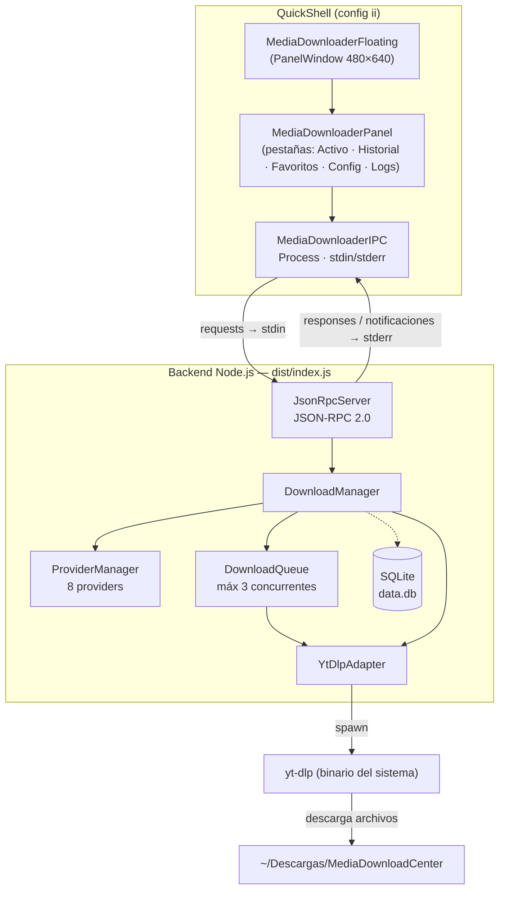
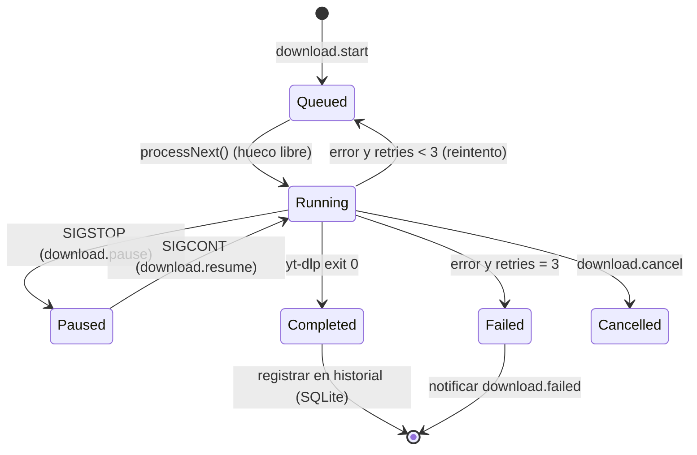
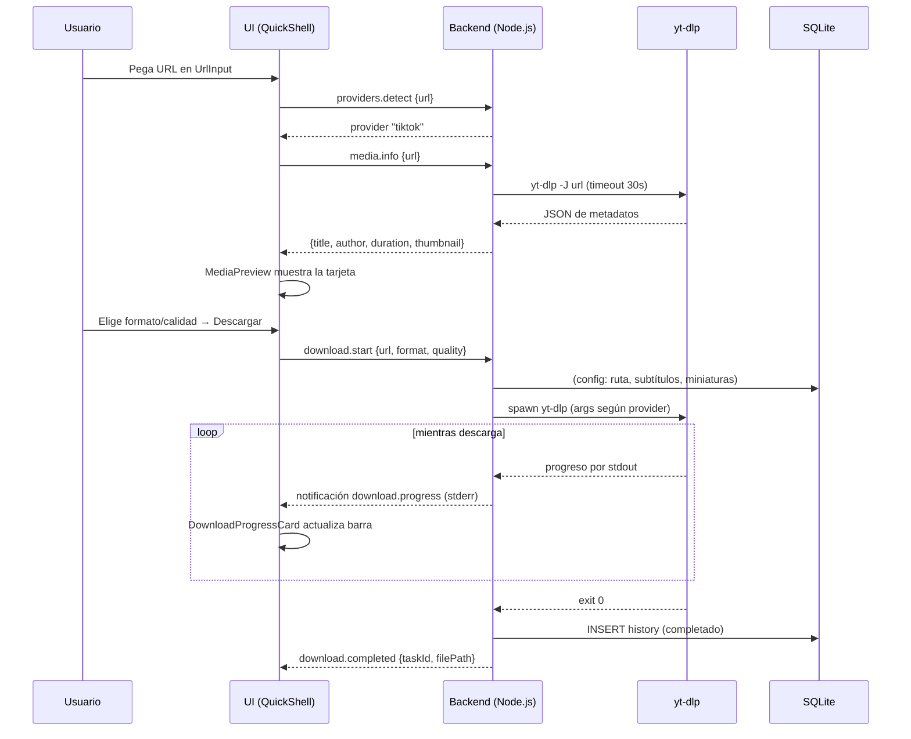
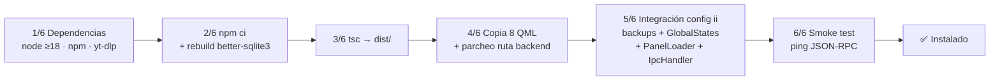

# 🗺️ Mapa de Funcionamiento — Media Download Center

> Mapa técnico completo de cómo funciona la app, cómo se instala y cómo quedó
> verificada en una sesión real de **Hyprland + QuickShell (Illogical-Impulse, config `ii`)**.
> Última verificación en vivo: 2026-09-30.

---

## ⚠️ Cambio de arquitectura en la v1.1: el backend es un DEMONIO

Hasta la v1.0 el backend Node era un **proceso hijo del panel**: cada UI
instanciaba su propio `MediaDownloaderIPC`, y dentro había un
`Process { running: true }`. Al cerrar la barra lateral (o al cambiar de pestaña
en el `BottomWidgetGroup`) QuickShell destruía ese componente, mataba el proceso
Node y, con él, los `yt-dlp` en curso. Eran además **dos o tres backends
simultáneos**, con dos colas independientes sobre la misma SQLite.

Desde la v1.1 el reparto es:

| | Proceso | Vive en | Se conecta |
|---|---|---|---|
| **Backend** | `node dist/index.js --daemon` | `media-download-center.service` (systemd --user) | Escucha en `$XDG_RUNTIME_DIR/media-download-center.sock` |
| **Frontend** | QuickShell | Config `ii` | `MediaDownloaderIPC` (singleton) abre un `Socket` |

Consecuencias prácticas:

- **Cerrar la barra lateral, cambiar de pestaña o recargar QuickShell NO
  interrumpe las descargas**: el demonio no es hijo de nadie y sigue trabajando
  sin ningún cliente conectado.
- **Un solo backend**: el widget del sidebar y el panel flotante ven la misma
  cola (antes cada uno tenía la suya).
- **Reanudación**: la cola se persiste en la tabla `persistent_queue` y, al
  arrancar el demonio, las tareas que quedaron en curso se re-encolan y yt-dlp
  continúa el `.part` (`--continue`).
- **La notificación `server.ready` se emite en cada conexión nueva**: es la
  señal que usa la UI para volver a pedir el estado (no se guarda nada en QML).

El transporte está abstraído en `src/ipc/Transport.ts` con dos
implementaciones: `StdioTransport` (compatibilidad con `npm start` y el smoke
test del instalador) y `SocketTransport` (el demonio).

---

## 1. Vista general

```
┌──────────────────────────── Hyprland (Wayland) ────────────────────────────┐
│                                                                             │
│  QuickShell (qs -c ii)                                                       │
│  ┌───────────────────────────────────────────────────────────────────────┐  │
│  │ shell.qml ── IpcHandler "mediaDownloader" (toggle/show/hide)            │  │
│  │      │                                                                │  │
│  │ GlobalStates.mediaDownloaderFloatingOpen ──┐                           │  │
│  │                                            ▼                           │  │
│  │ IllogicalImpulseFamily ── PanelLoader ── MediaDownloaderFloating        │  │
│  │                                          └─ MediaDownloaderPanel       │  │
│  │                                              ├─ UrlInput              │  │
│  │                                              ├─ MediaPreview           │  │
│  │                                              ├─ FormatSelector        │  │
│  │                                              └─ DownloadProgressCard  │  │
│  │                                          MediaDownloaderIPC (Scope)   │  │
│  │                                              └─ Process ───────────┐  │  │
│  └─────────────────────────────────────────────────────────────────│──┘  │  │
│                                                                    │       │  │
│              requests JSON-RPC ── stdin (Process.write) ──────────►│       │  │
│              responses/notificaciones ◄── stderr (SplitParser) ───┘       │  │
└─────────────────────────────────────────────────────────────────────────────┘
                                                                     │
                                                                     ▼
┌───────────────────────────── Node.js (dist/index.js) ───────────────────────┐
│ JsonRpcServer (readline sobre stdin → stderr)                               │
│      │ 25 métodos RPC registrados                                            │
│      ▼                                                                       │
│ DownloadManager (fachada)                                                   │
│      ├─► ProviderManager ─► 8 providers (YouTube, Twitch, TikTok,           │
│      │                        Instagram, Twitter/X, Vimeo,                  │
│      │                        SoundCloud, Bandcamp)                        │
│      ├─► DownloadQueue ──► concurrencia máx. 3 · reintentos máx. 3           │
│      │        │                pausa SIGSTOP / reanuda SIGCONT              │
│      └─► YtDlpAdapter ──► spawn(yt-dlp) ─► info (-J) · descarga · progreso  │
│                                                                              │
│ SQLite (better-sqlite3) ── ~/.local/share/media-download-center/data.db     │
│      ├─ HistoryRepository (historial + favoritos)                           │
│      └─ ConfigRepository  (ruta descarga, formatos, calidad...)             │
└──────────────────────────────────────────────────────────────────────────────┘
```



**Principio clave del IPC**: hay **un solo demonio** y varios clientes posibles.
Los requests y las respuestas viajan como JSON-RPC delimitado por saltos de
línea a través de un **socket Unix**; el servidor difunde las notificaciones
(*broadcast*) a todos los clientes conectados y responde solo al que hizo la
petición. El modo histórico por **stdin/stderr** (`--stdio`) se conserva para
`npm start` y para el smoke test del instalador, y ahí el QML ignoraba toda
línea que no empezara por `{` (heartbeat `HEARTBEAT`, trazas de yt-dlp).

---

## 2. Protocolo JSON-RPC 2.0 — mapa completo

### 2.1 Requests (QML → demonio, por socket Unix)

| Grupo | Método | Qué hace | Probado |
|-------|--------|----------|:-------:|
| Sistema | `ping` | Health check (versión yt-dlp, uptime) | ✅ |
| Providers | `providers.list` | Lista los 8 providers con capacidades | ✅ |
| Providers | `providers.detect` `{url}` | Detecta provider según patrones de URL | ✅ |
| Media | `media.info` `{url}` | Metadatos vía `yt-dlp -J` (título, autor, duración, miniatura) | ✅ |
| Media | `media.formats` `{url}` | Formatos disponibles |
| Media | `media.subtitles` `{url}` | Subtítulos disponibles |
| Descargas | `download.start` `{url, format, quality, extractAudio, ...}` | Valida URL → detecta provider → extrae info → encola | ✅ (UI) |
| Descargas | `download.pause` / `download.resume` `{taskId}` | SIGSTOP / SIGCONT del proceso yt-dlp |
| Descargas | `download.cancel` / `download.remove` `{taskId}` | Mata / elimina tarea de la cola |
| Descargas | `download.list` `{status?}` | Tareas con progreso y reintentos | ✅ (UI) |
| Descargas | `download.get` `{taskId}` | Detalle de una tarea |
| Historial | `history.list` / `history.favorites` `{limit, offset}` | Historial y favoritos (SQLite) | ✅ (UI) |
| Historial | `history.search` `{query}` | Búsqueda en historial |
| Historial | `history.toggleFavorite` / `history.delete` / `history.clear` | Mantenimiento del historial |
| Historial | `history.count` | Número de entradas | ✅ |
| Config | `config.get` `{key?}` | Config completa o una clave | ✅ |
| Config | `config.set` `{key, value}` | Persistir configuración |
| Config | `config.reset` | Volver a valores por defecto |
| Sistema | `system.status` | Cola activa, providers, historial, dataDir | ✅ |
| Sistema | `system.clearCompleted` | Limpiar completadas de la cola |

### 2.2 Responses y notificaciones (demonio → QML, por el mismo socket)

| Mensaje | Contenido | Consumo en QML |
|---------|------------|----------------|
| `server.ready` | `{version}` (al arrancar) | `backendReady = true` → señal `serverReady()` |
| response `{id, result/error}` | Respuesta a cada request | Resuelve la Promise de `pendingRequests[id]` |
| `download.progress` | `{taskId, progress: {percent, speed, eta, bytes}}` | Señal `downloadProgress` → barras de progreso |
| `download.status` | `{taskId, status, previous}` | Señal `downloadStatus` → refrescar lista |
| `download.completed` | `{taskId, title, filePath}` | Señal + registro en historial (SQLite) |
| `download.failed` | `{taskId, error}` | Señal `downloadFailed` → tarjeta en rojo |
| `queue.drained` | `{}` | Señal `queueDrained` |
| `server.shutdown` | `{}` (al cerrar stdin) | `backendReady = false` |

---

## 3. Ciclo de vida de una descarga



- **Concurrencia**: máx. 3 tareas `Running` simultáneas (config `maxConcurrentDownloads`).
- **Reintentos**: hasta 3 por tarea (`maxRetries`); al fallar se re-encola.
  Una tarea `Cancelled` **no** se reintenta (el evento de error del proceso
  terminado a propósito se ignora).
- **Progreso**: el adaptador parsea el stdout de yt-dlp (`--newline` +
  `--progress`), usando el marcador literal `progress:` dentro de
  `--progress-template` (el prefijo anterior al primer `:` es el *tipo* de
  plantilla y no se imprime), y emite `progress` → cola → notificación → QML.
- **Persistencia**: al completar se escribe en SQLite; la pestaña *Historial*
  lee con `history.list` / `history.favorites`.

---

## 4. Flujo end-to-end de una descarga



---

## 5. Mapa de archivos

### 5.1 Backend (`src/` → `dist/`)

| Archivo | Rol |
|---------|-----|
| `index.ts` | Punto de entrada: inicializa DB, services, providers, registra los 25 handlers RPC, heartbeats, shutdown graceful |
| `ipc/JsonRpcProtocol.ts` | Tipos y serialización JSON-RPC 2.0 |
| `ipc/JsonRpcServer.ts` | Lee stdin (readline), responde por **stderr**, notificaciones, `call()` remota |
| `core/DownloadManager.ts` | Fachada: valida URL, detecta provider, construye tareas, pausa/reanuda/cancela |
| `core/DownloadQueue.ts` | Mapa + orden de tareas, concurrencia máx. 3, reintentos, eventos de progreso |
| `core/ProviderManager.ts` | Registro y detección de providers por patrones de URL |
| `adapters/YtDlpAdapter.ts` | spawn de yt-dlp: `extractInfo` (-J, 30s), formatos, subtítulos, descarga con progreso |
| `providers/*Provider.ts` | 8 providers con formatos/calidades y capacidades por plataforma |
| `db/Database.ts` + repos | SQLite en `~/.local/share/media-download-center/data.db` |
| `services/*Service.ts` | Lógica de historial (favoritos, búsqueda) y config |
| `utils/UrlValidator.ts` | Validación de URL (protocolo seguro, etc.) |

### 5.2 Frontend QML (`qml/` → `~/.config/quickshell/ii/modules/ii/mediaDownloader/`)

| Archivo | Rol |
|---------|-----|
| `MediaDownloaderIPC.qml` | **Puente**: lanza el Process de Node, `sendRequest()` por stdin, parsea stderr, señales a la UI |
| `MediaDownloaderFloating.qml` | PanelWindow 480×640, namespace `quickshell:mediaDownloader`, visible según `GlobalStates.mediaDownloaderFloatingOpen` |
| `MediaDownloaderPanel.qml` | Panel completo: pestañas Activo/Historial/Favoritos/Config/Logs |
| `MediaDownloaderWidget.qml` | Variante compacta para integrar como pestaña inferior: preview/formato en zona desplazable y botón Descargar siempre visible |
| `UrlInput.qml` | Campo de URL con Ctrl+V del portapapeles, `Enter` (analiza o descarga) y Escape; sanea espacios/saltos al pegar |
| `MediaPreview.qml` | Tarjeta de previsualización (título, autor, duración, miniatura) |
| `FormatSelector.qml` | Selectores de audio, formato y calidad (formato + calidad en una fila para ahorrar alto) |
| `DownloadProgressCard.qml` | Tarjeta de progreso con barra, velocidad, ETA, pausa/cancelar |

### 5.3 Rutas en runtime

| Ruta | Qué es |
|------|--------|
| `~/.local/share/media-download-center/data.db` | Base de datos (historial, favoritos, config) |
| `~/Descargas/MediaDownloadCenter` | Carpeta de descargas por defecto (configurable) |
| `~/.config/quickshell/ii/modules/ii/mediaDownloader/` | Módulos QML instalados |
| `<repo>/dist/index.js` | Backend compilado (lanzado por el QML) |

---

## 6. Pipeline de instalación (`install.sh`)



| Paso | Detalle | Estado en la prueba |
|------|---------|----------------------|
| 1/6 | Verifica `node` (≥18), `npm`, `yt-dlp` en PATH | ✅ node v22.23.3 · npm 12.1.0 · yt-dlp 2026.08.19 |
| 2/6 | `npm ci` + **rebuild de better-sqlite3** (npm ≥11 omite build scripts nativos en modo no interactivo) + verificación del `.node` | ✅ (requirió el fallback `npm run install`) |
| 3/6 | `tsc` → `dist/index.js` | ✅ |
| 4/6 | Copia los 8 `.qml` y **sustituye `__BACKEND_DIR__`** por la ruta absoluta real del repo en la línea `command:` | ✅ → `["/usr/bin/node", ".../dist/index.js"]` |
| 5/6 | Backup único (`*.mdc-backup`) y ediciones **idempotentes** en: `GlobalStates.qml` (propiedad de visibilidad), `IllogicalImpulseFamily.qml` (import + `PanelLoader`), `shell.qml` (`IpcHandler target "mediaDownloader"`) | ✅ re-ejecución detecta "ya contiene…" sin duplicar |
| 6/6 | Lanza el backend, manda `ping` por stdin y valida `{"status":"ok"}` en stderr | ✅ `ytDlpVersion 2026.08.19` |

Flags: `--no-integrate` (no tocar la config ii) · `--uninstall` (restaura backups y borra el módulo).

---

## 7. Integración con Hyprland / QuickShell (ii)

Qué toca el instalador en `~/.config/quickshell/ii/`:

1. **`GlobalStates.qml`** → `property bool mediaDownloaderFloatingOpen: false`
2. **`panelFamilies/IllogicalImpulseFamily.qml`** →
   `import qs.modules.ii.mediaDownloader` +
   `PanelLoader { component: MediaDownloaderFloating {} }`
3. **`shell.qml`** → `IpcHandler` con target `mediaDownloader` (funciones
   `toggle`, `show`, `hide`)
4. **`modules/ii/sidebarRight/BottomWidgetGroup.qml`** → 4ª pestaña
   «Descargas» que carga `MediaDownloaderWidget.qml` (widget compacto con
   campo URL → preview → formatos → botón Descargar → mini cola)
5. **`~/.config/illogical-impulse/translations/es_MX.json`** → traducciones
   ES de los textos de la app (solo si el archivo no existe)

### Cómo abrir el panel

```bash
qs -c ii ipc call mediaDownloader toggle     # abre/cierra
qs -c ii ipc call mediaDownloader show       # solo abrir
qs -c ii ipc call mediaDownloader hide       # solo cerrar
```

Atajo de teclado (Hyprland en Lua → `~/.config/hypr/custom/keybinds.lua`):

```lua
hl.bind("CTRL + SUPER + D", hl.dsp.global("quickshell:mediaDownloaderFloatingToggle"),
    { description = "Shell: Toggle media downloader" })
```

> ⚠️ `SUPER + D` está ocupado por «Window: Maximize» en
> `~/.config/hypr/hyprland/keybinds.lua`, y `~/.config/hypr/hyprland.conf` no
> existe en esta instalación (la config es Lua).

### Recargar tras cambios

```bash
pkill -x qs && qs -c ii &          # reinicio completo
# o simplemente: qs -c ii ipc call panelFamily cycle
```

> ⚠️ **NUNCA reinicies QuickShell con la pantalla bloqueada**: la pantalla de
> bloqueo vive dentro de QuickShell y moriría con él (Hyprland mostraría
> *"lockscreen app died"*). Recuperación sin perder la sesión: lanzar
> `hyprlock` (crea un nuevo cliente de bloqueo) y escribir tu contraseña.

### Los botones de descarga

Dentro de la pestaña «Descargas» (o del panel flotante), los controles
**aparecen después de analizar un enlace**: pega la URL → Enter → el widget
consulta `media.info` → aparecen la vista previa, el selector de formato y el
botón **Descargar**. Con el campo vacío solo se ve el input con el texto
*"Pega un enlace para descargar..."*.

---

## 8. Resultados de la verificación en vivo (2026-09-30)

| # | Prueba | Resultado |
|---|--------|-----------|
| 1 | Compilación TypeScript | ✅ `dist/index.js` |
| 2 | Backend standalone: ping / providers.list (8) / providers.detect (YouTube) / config.get / system.status / history | ✅ todo responde por stdin→stderr |
| 3 | `install.sh` completo 6/6 | ✅ |
| 4 | Idempotencia (2ª ejecución no duplica ediciones) | ✅ |
| 5 | Ruta del backend parcheada en el QML instalado | ✅ `/usr/bin/node …/Proyectos/DownLoadsManagerEnd4/dist/index.js` |
| 6 | QuickShell reiniciado y módulo cargado | ✅ log: `Backend process started` → `Backend ready (v1.0.0)` |
| 7 | Backend lanzado **por el widget** en sesión viva | ✅ PID visible: `node …/dist/index.js` |
| 8 | Ventana flotante como capa Hyprland | ✅ `quickshell:mediaDownloader` 480×640 en `hyprctl layers` |
| 9 | `media.info` end-to-end con URL real del historial (TikTok) | ✅ `{provider:"tiktok", title:"#challeng #fy", author:"dilanbeats", duration:13}` |
| 10 | Captura de la ventana en pantalla | ✅ ver `docs/captura-viva.png` |

### 8.1 Segunda ronda: ciclo completo uninstall → install → descarga real

Repetida desde cero para confirmar que el script implementa la app de verdad:

| # | Prueba | Resultado |
|---|--------|-----------|
| 1 | `--uninstall`: módulo borrado + config restaurada desde backups | ✅ 0 restos de `mediaDownloader` en la config ii |
| 2 | Tras reiniciar QuickShell sin el módulo | ✅ ningún proceso backend (confirmación de que el widget es quien lo lanza) |
| 3 | Instalación limpia 6/6 (fallback nativo better-sqlite3 se activó solo) | ✅ |
| 4 | QuickShell reiniciado: módulo carga y el widget lanza el backend | ✅ handshake `Backend ready (v1.0.0)` |
| 5 | **Reinicio completo de la máquina**: QuickShell arrancó con la sesión Hyprland y el módulo cargó el backend **automáticamente al boot**, sin intervención manual | ✅ implementación persistente de sesión |
| 6 | Descarga real E2E (URL del historial, ruta ya usada): ciclo `queued → running → completed` + registro en historial con timestamp del día | ✅ |
| 7 | Descarga real a carpeta virgen: **transferencia de 4,2 MB verificada** + miniatura automática (47 KB) | ✅ ver RPC en el log de la sesión |
| 8 | `qs -c ii ipc call mediaDownloader toggle` abre la capa en la sesión viva | ✅ captura en `docs/captura-panel-abierto.png` |

### Problemas detectados y corregidos durante la prueba

| Problema | Causa | Corrección |
|----------|-------|------------|
| ❌ El QML apuntaba a `~/Descargas/DownLoadsManagerEnd4` (inexistente) | Ruta absoluta hardcodeada de una ubicación anterior del repo | El QML fuente usa `__BACKEND_DIR__` y `install.sh` lo parchea con la ruta real (paso 4/6) |
| ❌ El módulo nunca cargaba | No estaba registrado en la config ii | Paso 5/6: import + `PanelLoader` + propiedad en `GlobalStates` |
| ❌ No había forma de abrir el panel | Sin propiedad de estado ni IPC | Propiedad en `GlobalStates` + `IpcHandler` (`qs ipc call mediaDownloader toggle`) |
| ❌ `better-sqlite3` sin binario nativo | npm ≥11 omite scripts de build nativos sin TTY | Paso 2/6: `npm rebuild` + fallback `npm run install` + verificación del `.node` |
| ❌ El instalador "éxito" aunque npm fallara | `\|\| true` tragaba errores | Paso 2/6 ahora valida el binario nativo y falla con mensaje claro |
| ❌ Un paréntesis sin cerrar en install.sh | Typo en `$(grep …)` | Corregido + `bash -n` como verificación |
| ❌ La UI nunca mostraba progreso (barra fija en 0 %) y las descargas parecían quedarse a medias | `--print` implica `--quiet` (yt-dlp no imprime el progreso en modo silencioso) y el prefijo `download:` de `--progress-template` es el **tipo** de plantilla, no texto literal, así que el adaptador nunca recibía líneas de progreso | Paso `--progress` + marcador literal `progress:` en la plantilla; el adaptador emite `progress` de nuevo |
| ❌ Al cancelar, la descarga se reiniciaba sola y dejaba el archivo a medias | El evento `error` del proceso cancelado entraba en el reintento automático | `DownloadQueue` ignora los errores de tareas `Cancelled` |
| ❌ Se superaba la concurrencia máxima y quedaban "huecos" ocupados para siempre | `activeCount` se decrementaba dos veces (cancelación + error) y `remove()` sobre una tarea activa no liberaba el hueco | Cola de huecos como `Set` de tareas activas, liberado una sola vez por tarea |
| ❌ Procesos yt-dlp huérfanos (y `.part` que nunca terminaban) al pausar y cerrar la app | Un proceso detenido con `SIGSTOP` no procesa `SIGTERM`, y el `SIGKILL` de `killAll()` nunca llegaba a ejecutarse | `SIGCONT` antes de `SIGTERM` y escalado a `SIGKILL` correcto en `cancelDownload()` / `killAll()` |
| ❌ Tareas completadas sin `filePath` de forma intermitente | Los fragmentos de stdout no respetan los saltos de línea y `stdoutBuffer` nunca se rellenaba (el *fallback* `Destination:` era código muerto) | Buffer de líneas parciales + acumulado completo de stdout |
| ❌ `media.info` terminaba en "Request … timed out" sin motivo | El cliente esperaba 30 s y el backend tenía el mismo presupuesto, así que el timeout del cliente ganaba siempre y ocultaba el error real de yt-dlp | Cliente 75 s (`MediaDownloaderIPC.requestTimeout`) > backend 45 s; `--socket-timeout 15` evita cuelgues; `execYtDlp` distingue timeout de error y `parseError` devuelve la línea `ERROR:` de yt-dlp |
| ❌ Al pulsar `Enter` no ocurría nada | `accepted` no es fiable cuando hay manejadores `Keys` en la cadena (verificado: con `Keys.onReturnPressed` el `TextField` no emite `accepted`) | `UrlInput` captura `Return`/`Enter` con `Keys.onReturnPressed`/`onEnterPressed` + guarda anti-duplicados; y si el enlace ya está analizado, Enter **descarga** |
| ❌ Enlaces pegados con saltos de línea rompían el análisis | El texto se enviaba tal cual (`trim()` no quita espacios internos) | `UrlInput.cleanUrl()` elimina todo el espacio en blanco antes de enviar |
| ❌ YouTube/Instagram fallan con "Sign in to confirm you're not a bot" | Servicios que exigen sesión; yt-dlp sin cookies queda bloqueado (limitación ya conocida) | Config `cookies_from_browser` / `cookies_file` + sección **Cookies** en la pestaña Config; el adaptador añade `--cookies-from-browser` / `--cookies` a info, formatos, subtítulos y descargas |
| ❌ El buffer JSON de la UI podía corromperse y dejar *todas* las respuestas en timeout | Al concatenar un mensaje partido con el siguiente, el buffer nunca volvía a parsear | Si el buffer acumulado ya parece cerrado (o supera 512 KB) se descarta y se registra en Logs |
| ❌ En la barra lateral el botón **Descargar** quedaba fuera de la pantalla | El preview y los selectores crecían sin límite en un `ColumnLayout` sin margen para encogerse: con ~300 px de alto el botón salía hasta 96 px por debajo | Zona de preview/formato dentro de un `Flickable` acotado (`Layout.minimumHeight` 52/80 y máximo `min(contenido, 60 %/55 % del alto)`) y botón **fuera** de ella: siempre visible (verificado de 160 a 800 px). Además formato y calidad comparten fila (−44 px de alto) |

### Limitaciones conocidas (de plataformas, no del código)

- **YouTube** puede quedar bloqueado en `media.info` o en la descarga si la
  IP/entorno dispara protección anti-bot (`Sign in to confirm you're not a
  bot`). Solución implementada: **Config → Cookies (anti-bot)** con
  `cookies_from_browser` (firefox, chrome, chromium, brave, edge, opera,
  vivaldi) o `cookies_file` (ruta a `cookies.txt`). El adaptador lo traduce a
  `--cookies-from-browser` / `--cookies` en todas las llamadas a yt-dlp.
- **Vimeo** exige login desde 2025+ (`web client only works when logged-in`):
  el provider está limitado a credenciales/cookies.
- **Cierre de stdin**: el backend hace `process.exit(0)` al recibir EOF en stdin
  (comportamiento correcto para QuickShell, pipe persistente). Al probarlo desde
  terminal con `printf '...' | node dist/index.js`, los handlers lentos se
  cortan: mantener abierto el pipe, p. ej. `(printf '...'; sleep 12) \| node dist/index.js`.
- Miniaturas de algunas plataformas devuelven 403 desde el CDN (solo cosmético).

---

## 9. Desinstalación rápida

```bash
./install.sh --uninstall
# restaura GlobalStates.qml / IllogicalImpulseFamily.qml / shell.qml
# desde sus backups (*.mdc-backup) y borra el módulo QML.
```
